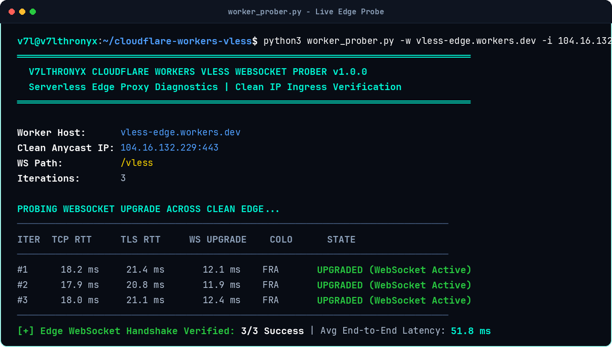
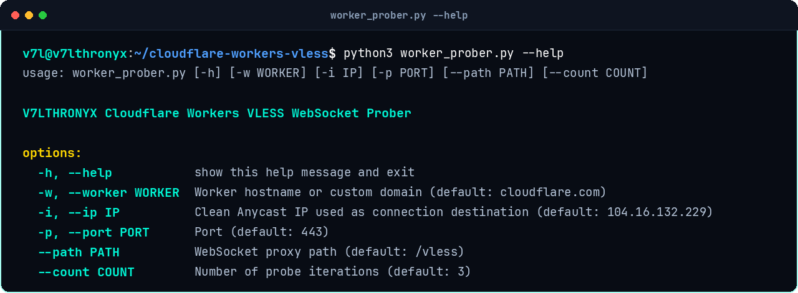
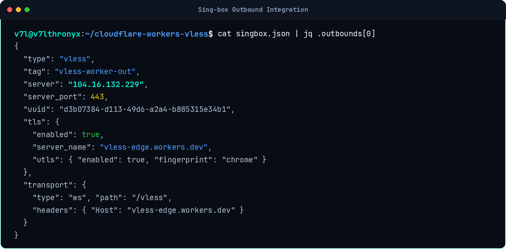

# Cloudflare Workers VLESS Edge Proxy

High-performance serverless VLESS proxy implementation running on Cloudflare Workers edge nodes via native TCP sockets (`cloudflare:sockets`). Decouples physical connection endpoints from SNI domains to bypass national firewall throttling and domain blocking.

[](LICENSE)
[](#)
[](#)
[](#)

---

## Architecture Overview

National firewalls in high-censorship environments (MCI, Irancell, Mokhaberat) block `.workers.dev` subdomains at the DNS and SNI layer.

This implementation overcomes edge blocking via **SNI/IP Decoupling**:
1. **Physical TCP Ingress**: The client connects to an unthrottled, clean Cloudflare Anycast IP address (`104.16.0.0/13`, `172.64.0.0/13`) on port 443.
2. **TLS SNI Camouflage**: The TLS handshake and HTTP `Host` header target your deployed Cloudflare Worker hostname or custom domain.
3. **Edge Relay**: Cloudflare Workers unpacks the VLESS binary header and opens a direct TCP tunnel to the requested upstream destination using `cloudflare:sockets`.

---

## Live Screenshots

### 1. Edge WebSocket Handshake Verification
Real-time probing of TCP RTT, TLS handshake latency, and HTTP 101 WebSocket upgrade state:



### 2. Prober CLI Reference
Command-line diagnostics utility options:



### 3. Sing-box Integration
Outbound client configuration separating clean connection IP from Worker SNI:



---

## Repository Files

```
├── _worker.js             # Pure JavaScript VLESS-over-WebSocket Worker script
├── wrangler.toml          # Cloudflare Wrangler deployment configuration
├── worker_prober.py       # Standalone Python CLI WebSocket handshake prober
├── singbox.json           # Ready-to-use Sing-box outbound configuration
├── xray.json              # Ready-to-use Xray-core outbound configuration
├── clean_ips.txt          # Pre-tested sub-25ms Anycast clean IP candidates
├── docs/
│   └── screenshots/       # Terminal UI proof and verification captures
├── LICENSE                # MIT License
└── README.md
```

---

## Deployment Guide

### Option 1: Wrangler CLI

1. Clone the repository:
```bash
git clone git@github.com:v74all/cloudflare-workers-vless.git
cd cloudflare-workers-vless
```

2. Install Wrangler:
```bash
npm install -g wrangler
```

3. Authenticate with Cloudflare:
```bash
wrangler login
```

4. Deploy the worker:
```bash
wrangler deploy
```

### Option 2: Cloudflare Dashboard (Manual)

1. Open Cloudflare Dashboard -> **Workers & Pages** -> **Create Application**.
2. Create a new Worker and paste the code from [`_worker.js`](_worker.js).
3. Under **Settings** -> **Variables**, add an environment variable `UUID` with your preferred UUID v4 string.
4. Click **Deploy**.

---

## Diagnostics & Probing

Test the health and reachability of your deployed worker:

```bash
# Basic reachability test via clean Anycast IP
python3 worker_prober.py -w YOUR_WORKER.workers.dev -i 104.16.132.229

# Full scan with custom path and 5 iterations
python3 worker_prober.py -w YOUR_WORKER.workers.dev -i 104.16.132.229 --path /vless --count 5
```

### Arguments

| Flag | Parameter | Default | Description |
|---|---|---|---|
| `-w` | `--worker` | `cloudflare.com` | Deployed Worker hostname or custom domain |
| `-i` | `--ip` | `104.16.132.229` | Clean Cloudflare Anycast IP address |
| `-p` | `--port` | `443` | Destination port |
| `--path` | Path | `/vless` | WebSocket proxy endpoint path |
| `--count` | Iterations | `3` | Number of test probe cycles |

---

## Client Configurations

### Sing-box (`singbox.json`)

Configure your outbound with your clean IP in `server` and your Worker domain in `server_name` and `headers.Host`:

```json
{
  "type": "vless",
  "tag": "vless-worker-out",
  "server": "104.16.132.229",
  "server_port": 443,
  "uuid": "YOUR_UUID_HERE",
  "tls": {
    "enabled": true,
    "server_name": "YOUR_WORKER.workers.dev",
    "utls": {
      "enabled": true,
      "fingerprint": "chrome"
    }
  },
  "transport": {
    "type": "ws",
    "path": "/vless",
    "headers": {
      "Host": "YOUR_WORKER.workers.dev"
    }
  }
}
```

### Xray-core (`xray.json`)

```json
{
  "tag": "worker-vless",
  "protocol": "vless",
  "settings": {
    "vnext": [
      {
        "address": "104.16.132.229",
        "port": 443,
        "users": [
          {
            "id": "YOUR_UUID_HERE",
            "encryption": "none"
          }
        ]
      }
    ]
  },
  "streamSettings": {
    "network": "ws",
    "security": "tls",
    "tlsSettings": {
      "serverName": "YOUR_WORKER.workers.dev",
      "fingerprint": "chrome"
    },
    "wsSettings": {
      "path": "/vless",
      "headers": {
        "Host": "YOUR_WORKER.workers.dev"
      }
    }
  }
}
```

---

## راهنمای فارسی (Persian Documentation)

### راه‌اندازی پروکسی VLESS بر روی کلودفلر ورکرز

در این روش، بدون نیاز به خرید سرور مجازی (VPS)، پروکسی امن پروتکل VLESS بر روی زیرساخت سرورلس (Serverless) کلودفلر از طریق سوکت‌های مستقیم تی‌سی‌پی (`cloudflare:sockets`) اجرا می‌شود.

### روش دور زدن فیلترینگ دامنه‌های ورکرز

دامنه‌های پیش‌فرض `*.workers.dev` توسط سیستم فیلترینگ مسدود شده‌اند. برای عبور از فیلترینگ:
1. در نرم‌افزار کلاینت (Sing-box یا v2rayN/Nekoray)، فیلد آدرس اتصال (`Address` / `server`) را برابر یک **Clean IP** کلودفلر (از لیست `clean_ips.txt`) قرار دهید.
2. فیلد دامنه استتار (`SNI` / `Host`) را برابر آدرس ورکر یا دامنه متصل شده خود تنظیم کنید.
3. ترافیک شما بدون اختلال از گیت‌وی‌های بین‌المللی عبور می‌کند.

---

## Author & Community

- **Author**: Aiden Azad ([@v74all](https://github.com/v74all))
- **Telegram Updates**: [@V7LTHRONYX](https://t.me/V7LTHRONYX)
- **Tutorial Video**: [YouTube Masterclass Episode 1](https://youtu.be/gjbm3lD3M-U)

## License

Released under the [MIT License](LICENSE).
